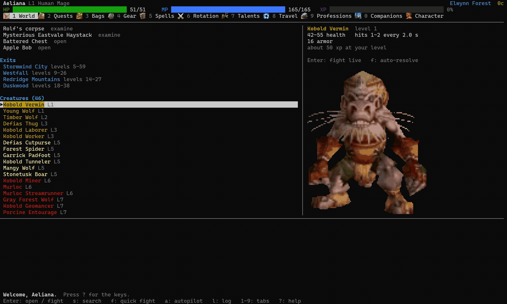
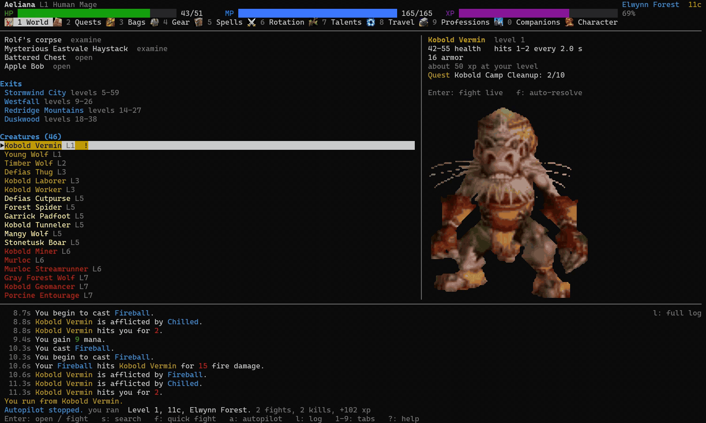
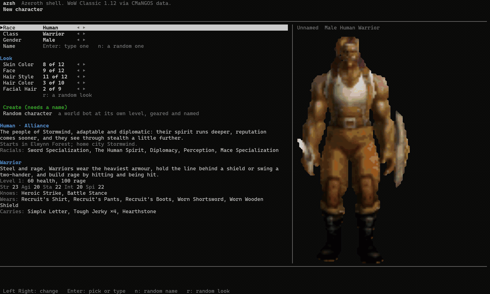
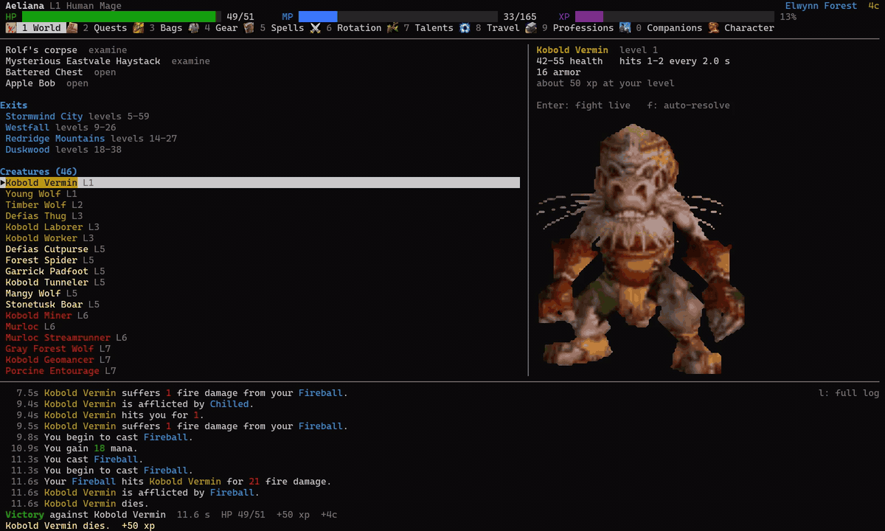
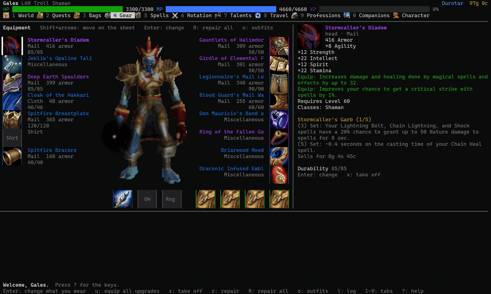
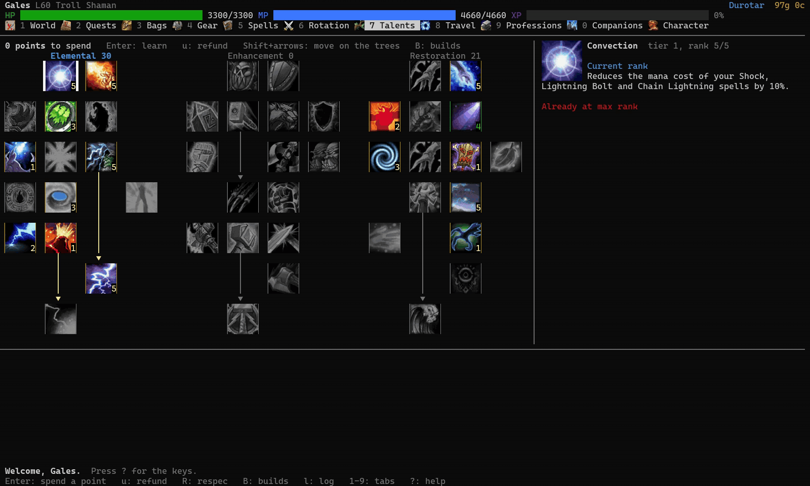
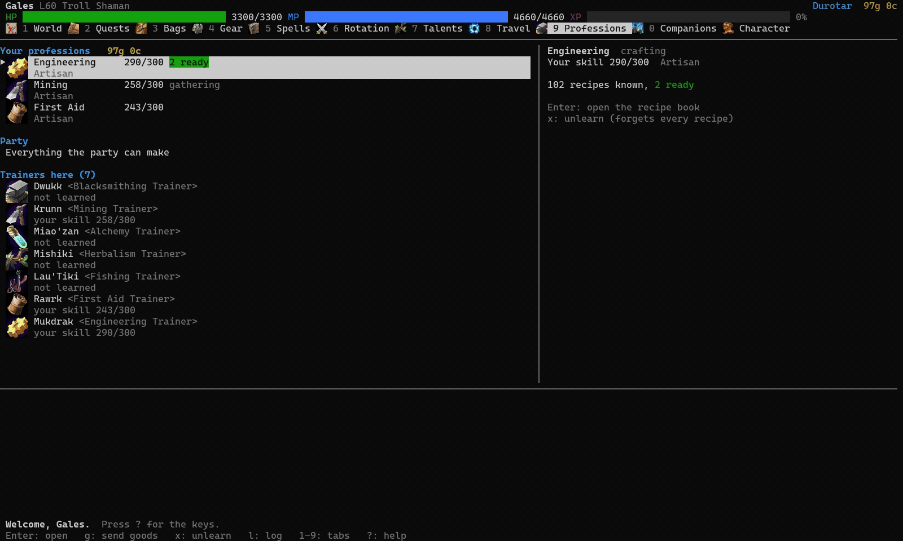
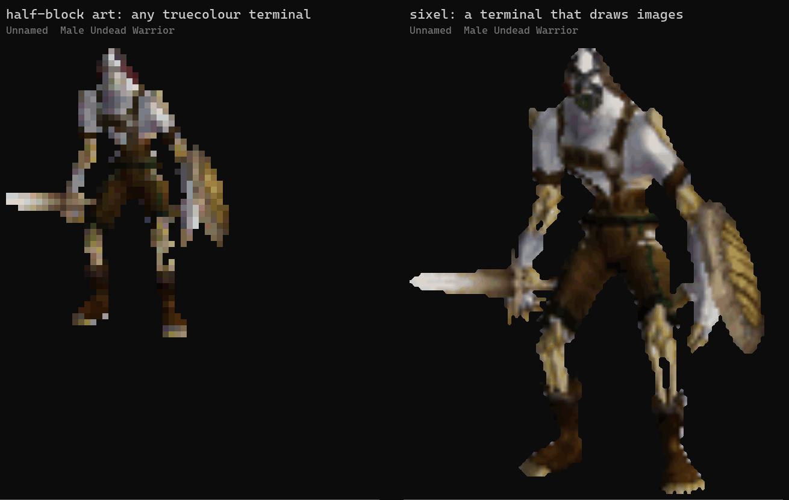

# azsh

Azeroth shell. A WoW Classic 1.12 text RPG that runs in the terminal, built on CMaNGOS Classic
data. The engine comes from another project of mine that is not released; this is its terminal
front end. No graphics, no browser, no build step.

> Personal, non-commercial fan project. World of Warcraft names, models, textures, icons and data are
> trademarks and copyrights of Blizzard Entertainment or its licensors. Classic-DB is part of the
> CMaNGOS Project; neither it nor this project is affiliated with or endorsed by Blizzard.



- [Install](#install)
- [Keys](#keys)
- [Playing](#playing): [character](#new-character) · [world and autopilot](#world-and-the-autopilot) ·
  [fights](#fights) · [rotation](#rotation) · [gear](#gear-and-bags) · [vendors, trainers, talents](#vendors-trainers-talents) ·
  [professions](#professions) · [companions](#companions) · [dungeons](#dungeons) · [city services](#city-services)
- [Art and terminals](#art-and-terminals)
- [Line mode and saves](#line-mode-and-saves)
- [Where it comes from](#where-it-comes-from)
- [Development](#development)

## Install

```sh
npx azeroth-shell             # run it straight from npm
npm install -g azeroth-shell  # or install it once, then:
azeroth-shell                 # pick a character or roll one (azsh for short)
```

From a checkout: `npm install -g .` or `node bin/azsh.mjs`.

Needs Node 22.18 or newer (it strips TypeScript types natively). No dependencies. The tree is
about 41 MB: 15 MB of gzipped game data, 12 MB of model art (creatures, and every item on every
body) and 13 MB of engine source.

## Keys

`azsh` opens the windowed game: a header with your pools and gold, eleven tabs, a cursor-driven
list with a detail pane beside it, and a scrolling log underneath. Nothing scrolls off the top;
every screen redraws in place.

| Key | Does |
| --- | --- |
| `1`-`9` `0`, `Tab`, `Left` `Right` | World, Quests, Bags, Gear, Spells, Rotation, Talents, Travel, Professions, Companions; Character is the last tab (`Tab`/`Left`) |
| `Up` `Down` `j` `k` | move the cursor; the right pane describes the row |
| `Enter` | act on the row: fight, open a quest, talk to a vendor or trainer, equip, cast, travel |
| `Esc` | close the window on top; on a tab, back to World |
| `PgUp` `PgDn`, `Home` `End` | page through a long list or a quest's text |
| `l` | open the whole log as a window (the pane below shows its tail) |
| `z` | sit and rest 30 s (health and power also tick back in real time while you stand) |
| `:` | the command line: every verb of the line game (`:rest 120`, `:auto 50 farm kobold`, `:help`) |
| `?` | the key list |

Each screen below has its own keys; they are listed with it.



## Playing

### New character

**New character** is one form: Race, Class, Gender, Name, then the body's own looks (skin, face,
hair style and colour, facial hair; horns and tusks where the race has them). The hero stands
beside the form in the starting gear as you change them, and under the form a card says what the
race and the class are and what a level 1 starts with: pools, attributes, racials, spells and gear.

| Key | Does |
| --- | --- |
| `Left` `Right` | change the row under the cursor |
| `Enter` on Race or Class | open the list with each choice drawn |
| `Enter` on Name | type a name |
| `n` | roll a name from the world's name pool |
| `r` | roll a look |
| `Esc` | back to the character list |

**Random character** rolls a world bot instead, at its own level, geared and named.



### World and the autopilot

**World** lists the quests on offer (`!` when you can take one, `?` when one is ready to hand in),
the people here, the exits and every creature you can hunt, coloured by level like the client.

| Key | Does |
| --- | --- |
| `Enter` on a creature | start a live fight |
| `f` | resolve the fight instantly |
| `a` | start the autopilot |

The autopilot accepts quests, picks targets, rests and hands in on its own, one planner step every
third of a second. Every fight it picks plays out live on screen with the same frames and combat
log as a fight you started yourself. Between fights it keeps its own panel (your frame and what it
is doing) instead of flashing back to the tabs.

| Key while the autopilot runs | Does |
| --- | --- |
| `1`-`9` | look at a tab |
| `w` | back to watching; in a fight, take the keys so `1`-`0` press the action bar (`w` or `Esc` hands them back) |
| `Esc` | stop it; during one of its fights, run away and stop it |



### Fights

Fights run on the engine's real-time session, ticking every 100 ms, on a stage: your sprite down
the left, the foe down the right (its size says its rank). Each has a plate under its feet (name,
level, class or rank, health, power), its cast or crowd control under that and its aura icons under
that. The foe stands at its real distance (the engine keeps positions in yards): a melee foe closes
in, a caster stays at range.

Hits rise from the chest, an auto-attack swing lunges the sprite, and a missile (a Fireball, an
arrow; never a strike) crosses the gap as a glyph. Your cast bar sits centred under the floor and
the keyed ability bar closes the scene; its slots never move, a cooldown or the cast in progress is
all they say, and the slot of a spell just used flashes. The 1.12 combat log streams into the log pane.

A party fight (companions along, a dungeon pull) is the same stage with every body small: the
party down the left (you in your gear, the companions in theirs, the pets a size under), the pack
down the right, and a narrow plate under each sprite with its role letter and name, its health as
a percent, its power, and under that its cast bar, crowd control or "dead". Each column stands by
its real distance to the other side, from the far edge to the lane at melee contact, and the
closing goes to whoever walked it: the healer hangs back, a mage walks into range, the tank runs
in, and a mob that runs onto the healer crosses the lane while the healer stays put. The sprites
take the widest box the terminal affords and shrink with the crowd; past the smallest the floor
counts who is out of frame. Terminals under 90 columns keep the list of unit frames.

Your rotation plays by default.

| Key | Does |
| --- | --- |
| `1`-`0` | fire that ability over the rotation |
| `a` | take full control |
| `Space` | pause |
| `+` `-` | run the fight faster or slower |
| `t` | (party fight) pause and give a companion an order: attack a target, cast an ability, hold ground |
| `p` | (dungeon) pull the next trash pack in too |
| `Esc` | run away |

### Rotation

**Rotation** is what auto-play casts for you: the same rule list the web editor edits, phase by
phase, every rule as a sentence. Rules are read top to bottom each tick and the first one whose
conditions hold fires.

| Key | Does |
| --- | --- |
| `Enter` on a rule | its menu: turn on or off, change when it fires, move, delete |
| `Enter` on `+ Add a rule` | pick a spell or combat item |
| Settings rows (bottom) | pick a spec or rebuild the recommended list |
| `K` `J` | move the rule up or down |
| `a`, `c`, `d` | add a rule, edit the condition, delete |
| `s`, `r` | pick a spec, rebuild the recommended list |
| `w` | whose rotation: yours or a companion's |
| `p` | rotation profiles: select, add, rename, delete |
| `D` | target dummy: run the rotation against a dummy |
| `A` | autopilot settings |

### Gear and Bags

**Gear** shows every slot with what you wear. `Enter` on a slot lists everything in your bags (and
in the bank, in a bank town) that fits it, with the stat, armor and damage difference in the detail
pane; `Enter` there puts it on. The engine's equipment helper scores your bags against what you
wear: upgrades are listed at the top of the tab and marked `▲` in Bags. From 160 columns the tab is
a character sheet: you in your gear in the middle, the worn pieces' icons down both sides, Shift+arrows
walking the slots.



| Key | Does |
| --- | --- |
| `Enter` on a slot | list what fits, then `Enter` to equip |
| `u` (Gear or Bags) | put on every upgrade at once |
| `x` | take a piece off |
| `b` (Bags) | open the bank, in a bank town |
| `g` (Bags) | open Send goods (see [Professions](#professions)) |

### Vendors, trainers, talents

**Vendors** open in a buy list with prices, stock and why a line is unavailable. A reagent your
party crafts with is flagged.

| Key | Does |
| --- | --- |
| `Tab` | flip to selling your bags |
| `j` | sell greys |
| `r` | repair |

**Trainers** show what you can learn now and what is coming up at which level.
**Talents** spend and refund points per tree. From 160 columns the tab draws the three trees side by
side as icon grids with their prerequisite arrows, Shift+arrows walking the tiers.



### Professions

**Professions** lists your trade skills and your companions', the profession trainers in the zone
and any Plans or Patterns in your bags. `Enter` on a profession opens its recipe book, coloured by
difficulty (orange always raises the skill, gray never). Short vendor reagents such as thread,
vials and flux are bought from your purse as you craft, the cost shown on the row.

| Key in a recipe book | Does |
| --- | --- |
| `Enter` | make one |
| `A` | make all you can |
| `N` | ask how many |
| `h` | show only what you can make |
| `/` | search |
| `c` | hand the book to a companion who knows the craft (they craft from the whole party's bags and banks) |



- **Enchanting** opens a bench instead: formulas apply to your gear or a party member's, and
  green-or-better bag items can be disenchanted.
- **Mining, Herbalism, Skinning and Fishing** list the zone's nodes (also on the World tab) with
  `Enter` to gather.
- **Everything the party can make** is one book across every crafter.
- **Send goods** (`g` here, in Bags or in Companions): trade goods go to the companions whose
  recipes use them and upgrades go on whoever gains, after you review it.

### Companions

**Companions** shows your party (up to four) and bench. At an inn, *Hire a companion* lists the
adventurers for hire with their gear and price.

Each companion's page sets their role, seats or benches them, gears them (`Enter` on a slot picks
from their bags and yours), gives and takes items, teaches them a profession and opens their recipe
book, or sends them on a gathering trip that pays out while you play.

The *Fights* row (`m`, or `:squad solo|elites|party`) says who comes along: Solo, companions only
against elites, or the whole party on every pull. That rule covers live fights, `f`, `:fight` and
the autopilot. Party frames show each companion's role, target and cast, and `t` in a fight pauses
it to give one of them an order.

### Dungeons

**Dungeons** sit under *Dungeons* on the World tab of the zone that holds their door (and on the
Travel tab), with any held run or raid lockout on the row. `Enter` opens the card before the door:
route (Bosses or Full), party or raid, who walks in (`f` fills from every companion you own to what
the instance wants), the 10/20/40-man raid group, the paladins' Blessings, and food and water for
everyone short of it.

Inside, the run window lists the rooms in route order with their stops (`B` boss, `T` trash,
`R` rare), the doors, levers and chests nearest each stop, and the NPCs with quests. Locked stops
say what opens them.

| Key | Does |
| --- | --- |
| `Enter` on an open stop | pull it live with the party (`p` in the fight pulls the next trash pack in too) |
| `Enter` on a gate / chest | use it / open it |
| `z` | rest and eat between pulls |
| `F` | run every remaining stop without watching; ends on a run report (damage, healing, loot, wipes) |
| `P` | open the Blessings board |
| `L` | leave (a 5-man is held for 30 minutes) |
| `R` | reset |

### City services

**City services** appear under *Services* on the World tab, above the people. `:bank`, `:ah` and
`:mail` open them from the command line.

**Bank**, in the six capitals and the goblin banker towns (`b` in Bags opens it too):

| Key | Does |
| --- | --- |
| `Tab` | flip between depositing and withdrawing |
| `n` | move part of a stack |
| `+` | buy a bank bag slot |
| `B` | slot a bag |

**Auction House**, in the capitals:

| Key | Does |
| --- | --- |
| `Tab` | cycle browse, sell and your own auctions |
| `Enter` | buy out |
| `b` | bid |
| `s` | search by name |

Selling asks quantity, bid, buyout and duration.

**Mailbox**, by every inn, where sales, refunds and overflow loot arrive:

| Key | Does |
| --- | --- |
| `Enter` | take a letter's money and items |
| `A` | empty the box |
| `d` | delete |

## Art and terminals

The colours are plain ANSI, so your terminal's theme sets the palette. For a CRT look turn on the
terminal's own retro effect (Windows Terminal: `"experimental.retroTerminalEffect": true` on the
profile; cool-retro-term elsewhere).

At 90 columns or wider the creature you face is drawn beside the fight frames and under its detail
on the World tab. Your own character, in the gear you wear, stands on the Character tab, on the
character picker, at creation and (from 130 columns) on the other side of the fight, and a
companion's page shows them the same way. It is truecolour half-block art baked from the game's
models; a terminal without 24-bit colour shows it in the nearest colours it has.

A terminal that draws sixel images (Windows Terminal 1.22+, WezTerm, foot, iTerm2; VS Code with
`terminal.integrated.enableImages`) gets every creature, every character in their gear and every
icon in real pixels instead. azsh asks the terminal at start.



| Variable | Does |
| --- | --- |
| `AZSH_SIXEL=0` | keep the half-block art |
| `AZSH_SIXEL=1` | turn sixel on for a terminal that does not say |
| `AZSH_HOME` | move the save folder (default `~/.azsh`) |

## Line mode and saves

Piped input, or `azsh --repl`, gives the line game instead: type `help` for its commands.
`azsh --tui` forces the windowed game even without a terminal, which is how it is driven through
pipes in tests. Keys are decoded from the raw byte stream, so a lone `Esc` acts at once.

Saves live in `~/.azsh/saves/`, one JSON file per character. `AZSH_HOME` moves that folder.

## Where it comes from

The engine, rules, world, quests, autopilot and data are taken as-is from a larger, unreleased
project of mine that runs the same game with a graphical front end. The data is the CMaNGOS Classic
world database plus a DBC bake, every table gzipped on disk (`src/cli/gzLoader.mjs` serves the
static imports). Everything the player reads traces to a CMaNGOS row or a 1.12 client string.
Nothing here is invented.

What is new here is the terminal front end in `src/cli/`:

| Module | Holds |
| --- | --- |
| `tui.mjs` | frame, input, dialogs |
| `tuiViews.mjs` | tabs |
| `tuiProfessions.mjs`, `tuiCompanions.mjs` | crafting, companions |
| `tuiFight.mjs` | live fight, autopilot |
| `repl.mjs` | line game and the shared verb table |

A few small UI modules (combat log wording, rotation sentences, dungeon floor scripts) are ported
from the same project.

The art is Blizzard's too. The icons are the 1.12 client's own icon textures; the creature sprites
and the geared character bodies are renders of the client's models. The packs in `src/data` are
small half-block reductions of them, and the full-size packs a sixel terminal downloads (the
`art-*` GitHub releases) are the same pictures at their native size. They are here for a
non-commercial fan project, nothing is sold or will be, and they come down on request.

What is not ported, and why, is the "Not porting" list in `PORT-PLAN.md`.

## Development

Checks:

```sh
npm run check        # boot the store, fight ten kobolds, save and reload
npm run check:tui    # drive the windowed game headlessly: tabs, quest, vendor, trainer, gear, bank,
                     # auction house, live fight, autopilot, crafting, hiring, send goods
npm run check:pipe   # the real terminal path through pipes: raw key bytes in, ANSI frames out, Esc, paging, quit
npm run check:all    # all three; add --frames to check:tui to print every screen
npm run check:perf   # timings, not pass/fail: module import, boot stages, heap, a repaint on every tab, a fight tick by tick
```

Data and art bakes:

```sh
npm run data:pack    # gzip the bake after a data refresh; data:unpack reverses it
npm run art:bake     # rebuild src/data/model-art.bin.gz from phonecraft's creature renders (needs ffmpeg)
npm run art:gear     # rebuild src/data/gear-art.bin.gz from phonecraft's paperdoll bake (needs Python with Pillow)
npm run art:icons    # rebuild src/data/icon-art.bin.gz from phonecraft's spell and item icons (needs ffmpeg)
npm run art:hd       # rebuild the full-size art sixel draws: model-art-hd.bin.br, icon-art-hd.bin.br and
                     # gear-art-hd/<body>.bin.br (needs ffmpeg, and Python with Pillow for the gear)
```

The pictures in this file are played, not drawn: `scripts/demo-record.mjs` runs the game on pipes with
a scripted player and logs every byte it writes with the time, and `scripts/demo-render.py` replays
the log through a small terminal emulator (cells, colours, sixel) and hands the frames to ffmpeg.

```sh
node scripts/demo-record.mjs new media/rec/new.jsonl --cols 160 --rows 48     # scenes: new, bot, art
python scripts/demo-render.py media/rec/new.jsonl --marks                      # the clips in a recording
python scripts/demo-render.py media/rec/new.jsonl --clip fight --gif media/fight.gif [--mp4 media/fight.mp4]
```
